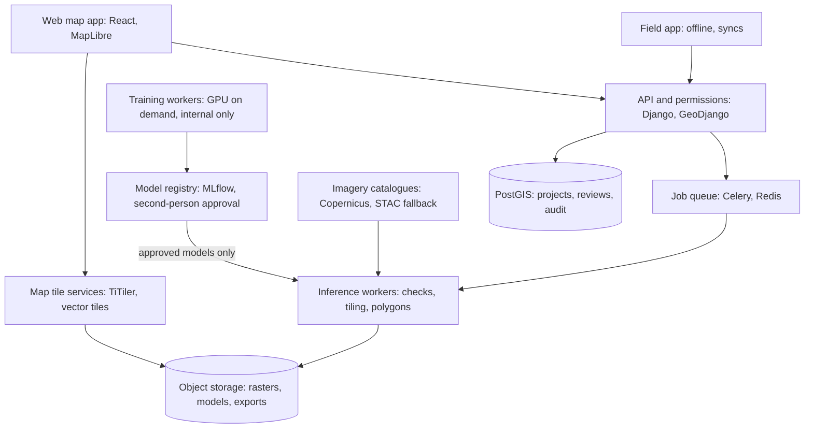
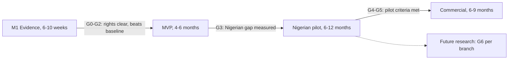

# Mining Footprint Detection Software: Functional Requirements Document

Nov 2, 2026 · @joshua

## 1. Executive summary

**Build a human-reviewed tool that maps candidate surface-mining footprints in Nigeria from Sentinel-2 imagery, and do not sell it as reliable until it has passed independent Nigerian testing.** The first release answers only where visible mining-like disturbance appears on a given date, and how sure the system is.

- **What it does.** An analyst selects an area and dates. The system checks the imagery, finds candidates, shows the evidence and records human review. Results export as maps, data and a report.
- **What it does not do.** It does not identify minerals, predict deposits, or establish legality or ownership. Change detection comes later, after its own test.
- **How it stays honest.** "No candidate found" is kept separate from "insufficient usable imagery". Scores are not called probabilities until calibrated.
- **How you see what you are doing.** Every stage has a visual check, from raw bands and masks to training curves and error maps. This starts in week 1 (Section 10).
- **How to train.** Do not train on the datasets one after another. Start with one Sentinel-2 baseline, add data in balanced batches only if tests support it, then fine-tune on Nigerian sites, keeping other sensors and tasks separate (Section 8).
- **Biggest open risks.** Licences for several datasets are unverified, one dataset record could not be confirmed, and global models may transfer poorly to Nigerian artisanal sites (Sections 6 and 14).
- **What comes first.** A 6 to 10 week evidence milestone with no web app (Section 15).

Reliability claims need four things: locked Nigerian test results with confidence intervals, independent or field validation, a cleared licence register, and a customer who acts on the output (Section 12).

## 2. Product purpose and measurable objectives

The product answers one question: **where, on a stated date and in stated imagery, is there visible land disturbance that looks like surface mining, and how sure are we?** Its output is a set of reviewable candidate polygons, never a finding about what is being mined, who is mining it, or whether it is legal.

### The five capabilities are separate claims

| Capability | What it says | Evidence needed | Status in this product |
| --- | --- | --- | --- |
| Mining-related disturbance detection | "This surface looks like mining disturbance on this date." | Single-date imagery and labelled footprints | **Core MVP** |
| Footprint change detection | "This footprint grew or shrank between two dates." | Comparable imagery on two dates, temporally separated testing | Later phase, only after gate G5 |
| Mineral type identification | "This site produces tin." | Field sampling, assays, operator records | Excluded. A footprint does not imply it |
| Undiscovered deposit prediction | "Ore is likely here." | Geology, geophysics, geochemistry, drilling | Excluded. A separate research product |
| Legal status or ownership | "This site is licensed, or belongs to X." | Official title records, legal review | Excluded. Imagery cannot establish it |

The interface, reports, exports and sales material must not imply the excluded capabilities. A detection is called a **candidate footprint**. Words such as "illegal", "unlicensed", "tin mine" or "verified mine" must not be generated by the software (see FR-110).

### Objectives

Every target below is a provisional hypothesis. None is an achieved result. Section 12 explains how each one is tested.

| ID | Objective | Measure | Provisional target |
| --- | --- | --- | --- |
| O1 | Find mining sites that exist | Site-level recall on the independent Nigerian test set, with confidence interval | At least 0.70 for sites of 1 ha or more |
| O2 | Keep review effort affordable | False candidates per 1,000 km², by landscape | At most 5 before review |
| O3 | Delineate usefully | Median IoU per correctly detected site | At least 0.50 |
| O4 | Be honest about unusable imagery | Share of false "no detection" results caused by unusable pixels | 0, tested by injecting cloud and no-data |
| O5 | Save analyst time | Analyst minutes per 100 km², compared with unaided digitising | At least 50% lower, measured with a real analyst |
| O6 | Be reproducible | Re-running a job with the same inputs and versions reproduces geometry | At least 99% area agreement |
| O7 | Control processing cost | Compute and storage cost per 1,000 km² per job | Measured in M1, then capped |
| O8 | Prove commercial value | Paying or signed pilot customers who act on outputs | At least 1 before the commercial release |

## 3. Assumptions, gaps and unresolved decisions

The design rests on the assumptions below. Each can be changed, and the owner should confirm them before M1 ends.

### Working assumptions

| ID | Assumption | Why it matters |
| --- | --- | --- |
| A1 | First customers are analysts in Nigeria: operators, due-diligence firms, ESG consultants or public agencies | Sets the report style and tolerance for false alerts |
| A2 | Sentinel-2 L2A at 10 m is the first sensor | It is free, global, repeat-visit and multispectral, including SWIR |
| A3 | Sites of 1 ha or more are the first target | Smaller workings approach the sensor's limit |
| A4 | Batch jobs are acceptable; results in hours, not seconds | Avoids always-on GPU cost |
| A5 | A human reviews every detection before external use | The software assists a decision and does not make it |
| A6 | A team of 2 to 4 people, including the founder | Sets the lean architecture and cost ranges |
| A7 | The company's own cloud account holds customer data, subject to legal review | Affects data residency and contracts |

### What the original brief left out

These gaps were found while preparing this document. Each now has a requirement or an open decision.

| Gap | Risk if ignored | Where it is handled |
| --- | --- | --- |
| **Visual inspection at every stage** | Pipeline errors stay invisible until a customer sees them | Section 10, FR-120 to FR-133 |
| **A written labelling protocol** | Each dataset and annotator means something different by "mine" | Section 8.2, FR-073 |
| **Hard negatives from Nigeria** | Quarries, farmland and riverbanks flood the review queue | Section 8.4, FR-074 |
| **Rare-class prevalence** | Enriched test sets overstate precision, because mining covers little land | Section 12.2 |
| **Design-based area estimates** | Summed polygon area is biased, yet customers will quote it | Section 12.3 |
| **Domain of applicability** | The model is silently used where it was never tested | FR-083, Section 8.6 |
| **Radiometric version control** | Sentinel-2 offset errors shift every pixel value | FR-032 |
| **Licence inheritance** | Share-alike labels may affect models and outputs | Section 6.3, FR-071 |
| **Harm from location data** | Outputs could expose or target vulnerable artisanal communities | Section 11.3, FR-005 |
| **Personal data in field evidence** | Photos and GPS tracks can identify people | Section 11.3, FR-095 |
| **Conflict of interest** | A mining operator who owns the validator is not independent | Section 12.5 |
| **Founder IP and platform status** | University affiliation may affect IP ownership and non-commercial access | Section 14.2, final questions |
| **Field-team safety** | Sites may be remote or contested | Section 12.4 |
| **Post-release drift monitoring** | Performance decays unseen as seasons and sites change | FR-105 |
| **Customer corrections and complaints** | A wrongly flagged site has no route to correction | FR-096 |
| **Named buyer and decision** | A technically sound map may have no paying user | O8, final questions |

### Unresolved decisions

| Decision | Default until decided | Decide by |
| --- | --- | --- |
| Minimum mapping unit | 0.5 ha display, 1 ha evaluated | Gate G2 |
| Scope of "mining-related": include roads and processing plants? | Include pits, dumps, tailings, ponds and plants; exclude access roads | Before annotation |
| Inactive or historic workings | Labelled as disturbance, with an activity attribute left unknown | Before annotation |
| Primary imagery access route | Copernicus Data Space, with a STAC mirror as fallback | M1 |
| Pilot geography | Two contrasting Nigerian regions chosen by the founder | Gate G3 |
| Company jurisdiction and data residency | Unresolved, needs legal advice | Before pilot contracts |

## 4. Scope and exclusions

The MVP is one Sentinel-2 Level-2A, single-date, batch detection workflow for an analyst-defined area in Nigeria, with human review and export.

**In scope for the MVP**

- Areas of interest up to 10,000 km² per job (configurable).
- Sentinel-2 L2A retrieval, plus upload of compatible Sentinel-2 L2A files.
- Binary segmentation: candidate mining disturbance versus everything else.
- Polygons, scores, evidence, explicit no-result reasons, human review and audit history.
- Exports to GeoJSON, GeoPackage, GeoTIFF and CSV, plus a PDF report.
- A controlled annotation pool and manual, approved model promotion.

**Out of scope for the MVP**

- Change detection, alerts and scheduled monitoring.
- Other sensors, including radar, Planet and very-high-resolution imagery.
- Classifying mine type, commodity, operator, activity level or legality.
- Underground workings with no visible surface expression.
- Automatic retraining, or customers uploading training data.
- A public map or a public API.
- Buyer matching, supply-chain traceability or certification.

**Detection limits that must be stated to customers**

- At 10 m per pixel, one hectare is 100 pixels. Pits and adits smaller than a few pixels are likely to be missed.
- Inactive, revegetated or flooded workings may be missed or may look like natural features.
- Quarries, borrow pits, construction sites, bare farmland, burn scars, seasonal riverbanks and dry ponds may cause false candidates.
- A clear image shows the surface on one date. It does not show current activity.

**The system must decline to give a confident result** when usable coverage is below threshold, the input fails schema checks, the area falls outside the model's validated domain, or the sensor or processing version is unsupported. FR-052 and FR-083 define these behaviours.

## 5. Users and workflows

Five roles cover the product, and a person may hold several. Customers see only what is released to them.

| Role | Can do | Cannot do |
| --- | --- | --- |
| Administrator | Manage users, organisations, quotas and audit logs | Approve models without the ML role, unless also assigned it |
| ML/data administrator | Ingest datasets, run training, register and propose models | Change customer projects |
| GIS analyst | Create projects, run jobs, review, edit and export | Promote models or change test sets |
| Field reviewer | View assigned sites, record evidence offline, propose status | Export whole projects or edit other teams' work |
| Customer viewer | View released results and download permitted reports | See unreleased candidates or other organisations' data |

### Customer-facing workflows

1. **Create a project.** The analyst names it, states its purpose and accepts the acceptable-use terms. The system creates an isolated project.
2. **Select an area.** The analyst draws it, enters coordinates or uploads GeoJSON, KML, Shapefile or GeoPackage. The system validates geometry, shows area and warns if it is outside the validated domain.
3. **Select dates.** The analyst sets a window. The system lists scenes on a timeline with cloud percentage and a coverage preview.
4. **Get imagery.** The system retrieves supported scenes, or the analyst uploads compatible files through resumable upload. Provenance is stored either way.
5. **Check quality.** The system shows true colour, false colour, masks and a usable-coverage map, then gives pass, warning or block with reasons.
6. **Run detection.** The analyst sees estimated cost, tiles and model version, then starts the job. Progress appears tile by tile on the map.
7. **View candidates.** The analyst sees polygons, score bands, the probability layer, imagery evidence and the map of areas not assessed.
8. **Review.** The analyst confirms, rejects, edits, marks uncertain or requests field checking. Every change is recorded with its evidence.
9. **Export and report.** The analyst selects a status filter and format. Reports state limits and model version automatically.

### Model workflows

10. **Add to the annotation pool.** A reviewer nominates a reviewed detection. It stays a candidate label until an independent annotator checks it (FR-075). Rejected detections may become hard negatives through the same check.
11. **Train and approve a model.** The ML administrator freezes a dataset version, runs training, inspects results, and compares against the current model on locked test sets. A second person approves or rejects promotion.
12. **Compare dates (later release).** After gate G5, the analyst selects two comparable observations. The system flags changed footprints and also reports where change could not be assessed.

## 6. Dataset assessment and compatibility matrix

The recommended starting point is the Global ML-ready dataset as the baseline, with Maus v2 as a label source, MineNetCD held back for change research, and a Nigerian set as the only evidence of Nigerian performance. None of these datasets has been cleared for commercial use yet.

### 6.1 Verification status

This tool could not open the Zenodo record pages or GitHub repositories directly, so some fields rest on secondary records. Treat **Not verified** as unknown, not as permitted.

| Dataset | Source actually read | Still to verify by hand |
| --- | --- | --- |
| MineSegSAT | [Paper on arXiv](https://arxiv.org/pdf/2311.01676) | Zenodo record 12667829 contents and licence, GitHub licence |
| Global ML-ready | [IIASA repository record](https://pure.iiasa.ac.at/20321) | Zenodo licence and file list |
| DRC ASM | Zenodo record 15257800 could not be opened | **Whole record.** See the warning below |
| Maus v2 | [IIASA abstract](https://pure.iiasa.ac.at/id/eprint/18508/), [licence note](https://pure.iiasa.ac.at/18508), [paper record](https://pure.iiasa.ac.at/18124) | PANGAEA page terms |
| MineNetCD | [Paper](https://arxiv.org/html/2407.03971v1), [RODARE metadata](https://rodare.hzdr.de/record/3251/export/schemaorg_jsonld) | Imagery provider terms, GitHub licence |

**Warning on the DRC dataset.** I could not confirm what Zenodo record 15257800 contains. A closely related study is [Pasanisi et al. 2025](https://www.mdpi.com/2072-4292/17/24/4057), but its data statement points to code on GitHub, not to this record. The DRC column below describes that paper and may not describe your record. Confirm the link before relying on it.

### 6.2 Compatibility matrix

| Attribute | MineSegSAT | Global ML-ready | DRC ASM (paper, link unconfirmed) | Maus v2 | MineNetCD | Future Nigerian set |
| --- | --- | --- | --- | --- | --- | --- |
| **Task** | Binary segmentation | Segmentation, plus bounding boxes | Binary ASM segmentation | Polygon inventory, not imagery | Bi-temporal change detection | Single-date segmentation first |
| **Label meaning** | Disturbed area: pits, dumps, ponds, tailings, leach pads, plants | Mining area from Maus and Tang, manually checked against dated imagery | Pseudo-labels from field points, clustering, masks and manual edits | Open cuts, tailings, dumps, ponds, plants and related features | Changed pixels, not mining presence | Defined by this project's protocol |
| **Geography** | Western Canada | 1,210 sites worldwide | Eastern DRC | Global, within 10 km of 34,820 listed mine coordinates | 100 sites, 6 continents | Nigeria |
| **Sensor and bands** | Sentinel-2, 12 bands | Sentinel-2 | Planet-NICFI 4.77 m (B, G, R, NIR) and Sentinel-1 | Digitised on Sentinel-2 cloudless 2019 | 1.2 m imagery via Earth Engine, provider unconfirmed | Sentinel-2 L2A, with VHR used for reference |
| **Dates** | Apr to Sep 2021 | Specific scene per tile; range not verified | Jan to Jun 2023 composites | 2019 | Pre 2009 to 2018, post 2018 to 2023 | To be collected, spanning seasons |
| **Size** | 134 tiles of 768 × 768 px at 10 m | 2048 × 2048 px tiles | 782 tiles | 44,929 polygons, 101,583 km² | 70k+ patches of 256 × 256 px | Target in Section 8.2 |
| **Imagery included?** | Paper links a Google Drive download; Zenodo not verified | **No.** References only; imagery must be fetched | Not verified | **No** | Yes, with its source terms unresolved | Depends on source |
| **Labels** | Masks | Masks and boxes, with type and scale metadata | Masks | Polygons, with control points | Change masks | Masks, with evidence grades |
| **Licence** | Not verified | Not verified | Not verified | **CC BY-SA 4.0** | **CC BY 4.0** for the dataset; imagery rights unresolved | Project-owned, subject to partner contracts |
| **Commercial use** | Unknown | Unknown | Unknown; Planet-NICFI terms are a concern | Allowed in principle, share-alike needs legal review | Dataset allowed, imagery unknown and a major concern | Yes, if contracts allow |
| **Preprocessing** | Reproject, resample 20 m and 60 m bands to 10 m | Fetch scenes, apply offsets, chip tiles | Different sensors; not reusable as Sentinel-2 input | Rasterise, and match to 2019 imagery | Different resolution and bands; separate pipeline | Full pipeline |
| **Relevance to Nigeria** | Low: boreal and alpine, mostly regulated large sites | Medium: includes artisanal labels, some African sites | Medium to high for ASM appearance; different climate and sensor | Medium: ASM coverage limited by the mine-coordinate source | Low for MVP: open pits and very high resolution | **Highest** |
| **Known overlap** | Labels from Tang and Werner | Labels from Maus and Tang | Uses IPIS points; independence to confirm | Source for the ML-ready set and MineNetCD site location | Sites located using global polygons | Must be checked against all others |
| **Recommended role** | External sanity test; do not pool blindly | **Baseline training** | Separate research branch | Label source and sampling frame; not an independent test | Separate change-detection research | **Independent test first**, fine-tuning from a separate split |

Sources: [MineSegSAT](https://arxiv.org/pdf/2311.01676), [Global ML-ready](https://pure.iiasa.ac.at/20321), [Pasanisi et al.](https://www.mdpi.com/2072-4292/17/24/4057), [Maus v2](https://pure.iiasa.ac.at/id/eprint/18508/), [MineNetCD](https://arxiv.org/html/2407.03971v1).

### 6.3 What this means in practice

- **The datasets cannot simply be pooled.** They differ in task, label meaning, sensor and date. MineNetCD labels change, so a stable pit is "no change" there but "mining" elsewhere.
- **Overlap breaks independence.** The ML-ready set derives from Maus and Tang, and MineSegSAT from Tang. Testing on one after training on another can leak the same sites.
- **Published scores are not targets.** MineSegSAT reports a [test F1 of 0.50](https://arxiv.org/pdf/2311.01676), and the DRC study [F1 of about 0.74 with fused Planet and radar data](https://www.mdpi.com/2072-4292/17/24/4057). They use different data, so they cannot be compared directly.
- **Maus has known omission.** Its control-point validation reports [producer's accuracy of 78.9% and user's accuracy of 97.2% for mines](https://pure.iiasa.ac.at/18508). Unlabelled pixels may therefore still be mining.
- **Share-alike needs a lawyer.** CC BY-SA 4.0 may reach derived label sets, and its effect on trained models is unsettled. Keep Maus-derived artefacts traceable so they can be removed.

### 6.4 Imagery access is a separate licence question

| Source | Finding | Consequence |
| --- | --- | --- |
| [Copernicus Data Space](https://dataspace.copernicus.eu/node/10) | Sentinel data is free, full and open. Other portal content is intended for non-commercial use, and availability is not guaranteed | Sentinel-2 is a sound base. Design for outages and quotas |
| [Earth Engine non-commercial tiers](https://developers.google.com/earth-engine/guides/noncommercial_tiers) | Monthly quotas of 150 or 1,000 EECU-hours, and projects must reverify non-commercial status yearly | A university project must not power a commercial product |
| [Earth Engine commercial pricing](https://cloud.google.com/earth-engine/pricing) | Basic plan $500 a month, Professional $2,000, compute from $0.40 per EECU-hour. Limited plan has no SLA and is not meant for enterprises | Treat it as optional. It is not required for the MVP |
| Planet-NICFI and Google Earth imagery | Terms not verified here | Do not use for commercial training or display until cleared in writing |

Free imagery does not mean free processing. Storage, egress and GPU time are real costs (Section 14.3).

## 7. Functional requirements

Each requirement below must pass its stated test before its phase closes. Priority shows the phase: **MVP**, **Pilot**, **Commercial** or **Future**. Roles: Admin, ML (ML/data administrator), GIS (analyst), Field (field reviewer), View (customer viewer). Visualisation requirements FR-120 to FR-133 are in Section 10.

### 7.1 Access and accounts

| ID | Requirement | Priority | Role | Depends on | Acceptance test |
| --- | --- | --- | --- | --- | --- |
| FR-001 | Users sign in with email and password, with multi-factor for privileged roles | MVP | All | None | Admin without a second factor is refused |
| FR-002 | Role-based permissions apply on every API call | MVP | Admin | FR-001 | Automated matrix test passes for every role and endpoint |
| FR-003 | Organisations are isolated from each other | MVP | Admin | FR-002 | A cross-organisation request by ID returns not found |
| FR-004 | Security actions and logins are recorded | MVP | Admin | FR-001 | Each listed event appears with user, time and object |
| FR-005 | Acceptable-use terms are accepted per project, and site locations can be marked restricted | Pilot | GIS, Admin | FR-010 | Restricted sites are hidden from exports and viewers without explicit permission |

### 7.2 Projects and areas of interest

| ID | Requirement | Priority | Role | Depends on | Acceptance test |
| --- | --- | --- | --- | --- | --- |
| FR-010 | Create, edit and archive projects with a stated purpose | MVP | GIS | FR-002 | Archived project is read-only and keeps its history |
| FR-011 | Define an area by drawing or by coordinates | MVP | GIS | FR-010 | Area matches a reference polygon within 0.1% |
| FR-012 | Upload boundaries as GeoJSON, KML, zipped Shapefile or GeoPackage | MVP | GIS | FR-010 | Valid samples load; self-intersecting or CRS-less files give a specific error |
| FR-013 | Enforce a configurable area limit per job, default 10,000 km² | MVP | GIS, Admin | FR-011 | Larger areas are refused with an option to split |
| FR-014 | Show whether an area is inside the validated domain | Pilot | GIS | FR-083 | Test areas outside the domain show a warning before the run |

### 7.3 Imagery discovery, ingestion and metadata

| ID | Requirement | Priority | Role | Depends on | Acceptance test |
| --- | --- | --- | --- | --- | --- |
| FR-020 | Search Sentinel-2 L2A scenes by area, dates and cloud cover | MVP | GIS | FR-011 | Results match a direct catalogue query on 10 reference areas |
| FR-021 | Retrieve selected scenes in a job, using cloud-optimised reads where available | MVP | GIS | FR-020 | Job fetches only intersecting data, and checksums are recorded |
| FR-022 | Upload compatible scenes with resumable transfer | Pilot | GIS | FR-030 | A 2 GB upload interrupted three times completes intact |
| FR-023 | Store full provenance per scene: ID, source, sensor, date, processing baseline, retrieval time, licence note | MVP | System | FR-021 | Every detection traces to its exact scene IDs |
| FR-024 | Fall back to a second catalogue when the primary fails | Pilot | System | FR-020 | Simulated outage completes through the fallback and records the source used |
| FR-025 | Block sources whose licence is not approved for the project's use | Pilot | Admin | FR-023 | A job using an unapproved source is refused with the reason |

### 7.4 Coordinates and input schema

| ID | Requirement | Priority | Role | Depends on | Acceptance test |
| --- | --- | --- | --- | --- | --- |
| FR-030 | Validate bands, data type, resolution, CRS, level and nodata against a versioned input schema | MVP | System | None | Each deliberately wrong sample is rejected with a named reason |
| FR-031 | Handle CRS explicitly: process in UTM, display in Web Mercator, export WGS 84 or the chosen CRS | MVP | System | FR-030 | Known control geometry stays within half a pixel after a round trip |
| FR-032 | Convert to reflectance using each product's metadata offset and processing baseline, not its acquisition date | MVP | System | FR-023 | Scenes before and after baseline 04.00 give consistent reflectance over stable targets |
| FR-033 | Use one shared preprocessing package in training and inference | MVP | ML | FR-030 | Same input gives byte-identical tensors through both paths |
| FR-034 | Compute area on an equal-area or local UTM basis | MVP | System | FR-031 | Area of a known polygon is within 0.5% |

### 7.5 Quality, cloud and coverage

| ID | Requirement | Priority | Role | Depends on | Acceptance test |
| --- | --- | --- | --- | --- | --- |
| FR-050 | Mask cloud, cloud shadow, nodata and saturated pixels using a versioned method | MVP | System | FR-030 | Mask agreement measured on a hand-labelled Nigerian sample and reported |
| FR-051 | Compute usable coverage per tile, per area and per observation | MVP | System | FR-050 | Values match a manual count on test scenes within 1% |
| FR-052 | Report four distinct tile outcomes: **candidate found**, **no candidate found in usable imagery**, **insufficient usable imagery**, **not processed** | MVP | System | FR-051 | Cloud-covered synthetic tile never returns "no candidate found" |
| FR-053 | Apply configurable coverage thresholds that warn or block | MVP | GIS, Admin | FR-051 | Default: warn below 80%, block below 40%, both flagged as provisional |
| FR-054 | Flag haze, smoke, burn scars and flooding risk for review where detectable | Pilot | System | FR-050 | Flags evaluated on labelled examples, with rates reported |

### 7.6 Tiling and large areas

| ID | Requirement | Priority | Role | Depends on | Acceptance test |
| --- | --- | --- | --- | --- | --- |
| FR-060 | Split areas into overlapping tiles and blend overlap | MVP | System | FR-031 | No visible seam in a test mosaic; overlap is configurable |
| FR-061 | Build per-date mosaics with a deterministic scene order, recording each pixel's source | MVP | System | FR-023 | Same inputs give the same mosaic; source lookup returns the right scene |
| FR-062 | Handle UTM zone and tile boundaries | MVP | System | FR-060 | An area crossing zones yields continuous polygons with correct area |

### 7.7 Training data, annotation and splits

| ID | Requirement | Priority | Role | Depends on | Acceptance test |
| --- | --- | --- | --- | --- | --- |
| FR-070 | Ingest external datasets through dataset-specific adapters into a common schema | MVP | ML | FR-030 | Each adapter passes schema checks and reports rows dropped |
| FR-071 | Attach licence, source, version and permitted uses to every dataset and sample | MVP | ML | FR-070 | A model's lineage lists every licence; a dataset can be withdrawn and affected models identified |
| FR-072 | Detect duplicate and overlapping scenes and labels across datasets | MVP | ML | FR-070 | Seeded duplicates across datasets are all flagged |
| FR-073 | Maintain a versioned labelling protocol, and record the version on each label | MVP | ML | None | Each label shows its protocol version; two annotators reach measured agreement |
| FR-074 | Tag hard negatives by type: quarry, borrow pit, farmland, riverbank, burn scar, settlement | Pilot | ML, GIS | FR-073 | Negative counts per type are reported for each dataset version |
| FR-075 | Move reviewed detections to ground truth only through independent QC | Pilot | ML | FR-091 | A reviewer cannot approve their own example; no direct path exists |
| FR-076 | Provide brush, polygon and split-merge annotation on imagery | Pilot | GIS, ML | FR-120 | Annotator completes a sample task and exports a valid mask |
| FR-077 | Assign splits by site and geographic block, and lock the test set | MVP | ML | FR-072 | No site or buffered block appears in two splits; a locked test set cannot be edited |
| FR-078 | Fit normalisation on training data only, and store it with the model | MVP | ML | FR-077 | Code audit and an automated check confirm the statistics source |

### 7.8 Training, tracking and registry

| ID | Requirement | Priority | Role | Depends on | Acceptance test |
| --- | --- | --- | --- | --- | --- |
| FR-100 | Define runs by a versioned configuration | MVP | ML | FR-078 | A run can be repeated from its stored configuration |
| FR-101 | Record code commit, dataset version, configuration, metrics, artefacts and environment per run | MVP | ML | FR-100 | A missing field stops the run from being registered |
| FR-102 | Register models with lifecycle states and input schema | MVP | ML | FR-101 | Inference refuses a model whose schema does not match |
| FR-103 | Compare a candidate with the current model on the same locked sets, per stratum | MVP | ML | FR-102 | Report generated automatically; no promotion without it |
| FR-104 | Require a second person to approve promotion, and allow one-step rollback | Pilot | ML, Admin | FR-103 | Self-approval is refused; rollback restores the prior model and is logged |
| FR-105 | Monitor input and output drift, and review-rejection rates, per region and season | Commercial | ML | FR-091 | A simulated shift raises an alert |

### 7.9 Inference and jobs

| ID | Requirement | Priority | Role | Depends on | Acceptance test |
| --- | --- | --- | --- | --- | --- |
| FR-080 | Run batch inference asynchronously on a queue, separate from training | MVP | GIS | FR-102 | Closing the browser does not affect a running job |
| FR-081 | Segment candidate mining disturbance per pixel using the approved model | MVP | GIS | FR-080 | Output reproducible, within tolerance, on the reference area |
| FR-082 | Convert rasters to polygons with a configurable threshold and minimum mapping unit, storing both | MVP | GIS | FR-081 | Polygons below the unit are removed; geometry is valid in all exports |
| FR-083 | Decline or flag when usable coverage is low, the schema fails, or the area or season is outside the validated domain | MVP | System | FR-052 | Each case gives a labelled result, never a silent score |
| FR-084 | Show scores as bands, and call them "calibrated probability" only for models that passed calibration testing | MVP | System | FR-102 | Uncalibrated model UI and exports say "model score" |
| FR-085 | Give job states, per-tile progress, retries with backoff, cancellation and resume | MVP | GIS | FR-080 | A worker killed mid-job resumes without repeating finished tiles |
| FR-086 | Show estimated and actual processing cost, compute and storage per job | Pilot | GIS, Admin | FR-080 | Actual cost is within 25% of the estimate on test jobs |
| FR-087 | Enforce per-organisation quotas | Pilot | Admin | FR-086 | A job above quota is refused with an explanation |

### 7.10 Review, audit and reporting

| ID | Requirement | Priority | Role | Depends on | Acceptance test |
| --- | --- | --- | --- | --- | --- |
| FR-090 | Show each candidate with its evidence panel | MVP | GIS | FR-124 | Panel shows imagery, score, scene, date, model, area |
| FR-091 | Allow confirm, reject, edit, mark uncertain, request field check, with reason codes | MVP | GIS | FR-090 | Every action needs a reason code; edits keep both geometries |
| FR-092 | Keep an append-only audit history per detection | MVP | System | FR-091 | History cannot be edited by any role through the application |
| FR-093 | Let analysts add missed sites, recorded as false negatives | MVP | GIS | FR-091 | Added polygons are counted separately in review statistics |
| FR-094 | Search and filter by status, score, area, date, model, reason and region | MVP | GIS | FR-091 | Filter results match a direct database query |
| FR-095 | Record field evidence offline: GPS, photos, notes, time, observer. Strip or blur people where required, and restrict access | Pilot | Field | FR-091 | Offline visit syncs correctly; photo access follows role rules |
| FR-096 | Accept and track a correction request on a released result | Commercial | Admin | FR-092 | Request has an owner, state and outcome in the audit trail |
| FR-106 | Export GeoJSON, GeoPackage and CSV for vectors, GeoTIFF for rasters | MVP | GIS | FR-094 | Exports open in QGIS and pass schema validation; CSV states its geometry form |
| FR-107 | Generate a PDF report with maps, method, coverage, limits, versions and evidence grades | MVP | GIS | FR-106 | Report cannot omit the coverage map or limits section |
| FR-108 | Give a data licence and attribution notice with each export, including Copernicus credit | MVP | System | FR-023 | Notice appears in every export package |
| FR-109 | Sign exports with a manifest and checksums | Commercial | System | FR-106 | Altering a file fails verification |
| FR-110 | Control product wording. Generated text must not assert commodity, legality, ownership, operator or current activity | MVP | System | None | Template test rejects a banned term list; reviewers may add evidence notes, labelled as their own |
| FR-111 | Later: compare two observations, with "not comparable" outcomes | Future | GIS | Gate G5 | Tested on temporally separated labels |

Each exported detection carries the fields in Section 9.2.

## 8. ML training, evaluation and release requirements

Do not train on the datasets one after another as your main method. Train a baseline on one Sentinel-2 dataset, add data deliberately in balanced batches, fine-tune on Nigerian examples, and keep other sensors and tasks in separate branches.

### 8.1 Your sequential-training idea, evaluated

Fine-tuning in sequence tends to favour the last dataset and lose earlier skill, which is called catastrophic forgetting. It also makes results depend on dataset order, so it is hard to tell why performance changed.

| Strategy | Strength | Weakness | Verdict |
| --- | --- | --- | --- |
| One suitable dataset as baseline | Simple, and exposes pipeline errors | Limited variety | **Do first** |
| Sequential fine-tuning | Cheap, and needs only the latest data | Forgetting, order effects, unclear cause of change | Use only for the final Nigerian step, with replay |
| Balanced multi-dataset training | Keeps variety in each batch, tests all sources each time | Label conflicts need resolving first; only same-sensor data | **Do second**, if gate G2 shows benefit |
| Pretrained model transfer | Helps with few labels | Band mismatch, licence checks, may not fit 12-band input | **Test early** |
| Nigerian fine-tuning | Targets the real domain | Few labels, overfitting risk | **Do third**, freezing most layers and replaying global data |
| Separate models by sensor or task | Clear, and each is honestly evaluated | More to maintain | **Required** for radar, Planet, VHR and change |

### 8.2 Label problems to solve first

- **Domain shift.** Canadian open pits and Nigerian alluvial workings look different in spectrum, shape and scale. Performance elsewhere predicts little.
- **Conflicting labels.** Sources differ on whether ponds, plants and roads count. Map each one to the protocol, or mask ambiguous pixels from the loss.
- **Incomplete negatives.** An inventory that omits a mine makes real mining look like background. Sample negatives away from mine-coordinate bias, and treat unlabelled pixels near known sites with care.
- **Class imbalance.** MineSegSAT reports [roughly 4% mining pixels, even in tiles selected for mining](https://arxiv.org/pdf/2311.01676). Use overlap-aware or focal loss and tile sampling, and test on natural prevalence.
- **Industrial versus artisanal.** Report them separately. Consider a size-weighted loss so large pits do not dominate.

**Nigerian set target (a hypothesis):** 300 to 600 site examples, split by geographic block and spanning at least two seasons, plus an equal share of hard negatives. Keep at least 100 sites in a locked test set the model never touches. Gate G3 adjusts these numbers using learning curves.

### 8.3 Experiment sequence and decision gates

| Step | Experiment | Passes when | If it fails |
| --- | --- | --- | --- |
| G0 | Licence and data audit, reproduce 20 sites end to end | Each dataset has a recorded permitted use; imagery and labels align visually | Replace the dataset |
| G1 | Simple baseline: a spectral-index threshold and a random forest on pixels | Metrics recorded per stratum on held-out sites | Fix the pipeline before using deep learning |
| G2 | Segmentation: U-Net with a ResNet encoder, then one transformer such as SegFormer | Beats G1 at site level by a margin beyond its confidence interval | Revisit labels; do not add complexity |
| G3 | First test on Nigerian sites, no Nigerian training | Gap between global and Nigerian performance is measured | The gap sets the annotation budget |
| G4 | Nigerian fine-tuning with replay, plus learning curve | Nigerian score improves with no significant global loss, on locked sets | More data, or narrow the validated domain |
| G5 | Calibration, threshold selection, field validation, pilot release decision | Section 12 criteria are met | Stay in internal or assisted-service mode |
| G6 | Optional branches: multi-temporal input, Sentinel-1, change detection | Beats the production model on its own claim, with temporal separation | Keep as research |

Start with 2 to 3 experiments per step. Do not tune on test data or begin hyperparameter search before G2.

### 8.4 Mandatory training rules

| ID | Rule | Evidence required |
| --- | --- | --- |
| ML-01 | Keep a simple baseline in every comparison | Baseline row in every report |
| ML-02 | Use identical preprocessing in training and inference | Shared package, test in FR-033 |
| ML-03 | Separate train, validation and test by site and geographic block, with a buffer | Split map and leakage test |
| ML-04 | Use temporal separation when testing change claims | Dates listed per split |
| ML-05 | Detect duplicates and overlapping scenes across datasets | Overlap report per dataset version |
| ML-06 | Fit normalisation on training data only | Statistics source recorded |
| ML-07 | Keep the Nigerian test set independent of training and threshold selection | Access log, hash of locked set |
| ML-08 | Include hard negatives by type | Counts and per-type false-alert rates |
| ML-09 | Version dataset, code, configuration and model | Lineage record |
| ML-10 | Compare with the previous model before promotion | FR-103 report |
| ML-11 | Roll back when a new model is worse | Rollback tested before each release |

### 8.5 Scores and calibration

A model score is not a probability. Call it calibrated only after testing on data held out from training and threshold selection, with a reliability diagram and expected calibration error, measured per stratum. Calibration at one location or season may not carry over, so recheck it per region.

### 8.6 Domain of applicability

Each model's release card must state where it may be used: regions, seasons, sensor, processing versions, site sizes and mining types tested. Inputs outside this domain trigger FR-083.

### 8.7 Release criteria

A model may be promoted only if all these are true:

1. Its lineage is complete and its licences allow the intended use.
2. It meets the pilot targets on the locked Nigerian test set, or an approved exception narrows its domain.
3. Site-level recall does not fall by more than 3 percentage points in any major stratum, unless justified in writing.
4. False alerts per 1,000 km² do not worsen beyond the agreed tolerance.
5. A reviewer has inspected error maps, including false negatives (FR-129).
6. Rollback has been tested, and a second person approves.

## 9. Data model and interfaces

The data model keeps four things separate: what was observed, what the model said, what a person decided, and what was released.

### 9.1 Main entities

| Entity | Key fields | Relationships | Validation rules |
| --- | --- | --- | --- |
| Organisation | Name, quotas, region | Has users, projects | Isolation key on all child records |
| User | Email, roles, MFA state | Belongs to organisation | Privileged role needs MFA |
| Project | Name, purpose, status | Has areas, observations, jobs | Purpose and acceptable-use acceptance required |
| AreaOfInterest | Geometry, source, area km², CRS | Belongs to project | Valid geometry, within size limit |
| Scene | Source ID, sensor, datetime, baseline, cloud %, licence | Used by observations | Unique source and ID; baseline required |
| Observation | Date window, scene list, mosaic rule, coverage % | Belongs to area | Scenes share one input schema |
| Tile | Grid ID, state, usable %, outcome | Belongs to job | Outcome is one of the four in FR-052 |
| Job | Type, state, model, parameters, cost, times | Runs on observation | Parameters immutable after start |
| Detection | Geometry, area, score summary, threshold, MMU | Created by job | Valid polygon in stated CRS |
| Review | Action, reason, reviewer, geometry before and after, time | Belongs to detection | Append-only; reason required |
| Evidence | Type, grade, file, source date, observer, access level | Belongs to review | Grade and date required |
| Dataset and Version | Source, licence, adapter, hash, protocol version | Contains samples | Licence field required |
| Sample | Tile, label, split, mining type, scale, quality | Belongs to dataset version | Split locked after freeze |
| Run | Commit, config, dataset version, metrics, artefacts | Produces model version | All lineage fields required |
| ModelVersion | State, input schema, norm stats, calibration, domain, card | Comes from a run | Schema and card required before approval |
| AuditEvent | Actor, action, object, time, before, after | References any object | Append-only |

### 9.2 Exported detection fields

| Field | Meaning |
| --- | --- |
| project\_id, detection\_id | Stable identifiers |
| geometry, crs | Polygon and coordinate system |
| area\_ha, area\_method | Area, and how it was computed |
| imagery\_start, imagery\_end, scene\_ids, sensor, processing\_baseline | Exactly what was seen |
| usable\_coverage\_pct | Local usable coverage around the detection |
| model\_version, input\_schema\_version | What produced it |
| threshold, min\_mapping\_unit\_ha | Settings used |
| score\_mean, score\_band, score\_type | Summary, labelled "model score" or "calibrated probability" |
| review\_status, review\_reason, reviewer\_role, reviewed\_at | Human decision, with role rather than name by default |
| evidence\_grade, evidence\_notes | Strongest evidence type, from E0 to E3 below |
| processed\_at, statement | Timestamp, and a standard limitation statement |

**Evidence grades:** E0 is model only. E1 is analyst review on the same imagery. E2 is independent VHR or dated reference imagery. E3 is direct field or operator verification.

### 9.3 API capabilities

| Area | Capabilities |
| --- | --- |
| Auth | Sign in, tokens, roles |
| Projects | Create, list, update, archive |
| Areas | Create from geometry or upload; validate |
| Imagery | Search, retrieve, upload session, quality report |
| Jobs | Estimate, start, status, tile states, cancel, resume |
| Detections | List, filter, get evidence, tiles for map |
| Reviews | Submit action, history, bulk status for selection |
| Exports | Request, status, download, manifest |
| Datasets and annotations | Ingest, list, overlap report, QC queue, freeze version |
| Runs and models | Register, compare, propose, approve, roll back |
| Visual layers | XYZ or COG raster tiles and vector tiles, with organisation checks |
| Admin | Users, quotas, usage, audit search |

The API is private in the MVP. It should follow OpenAPI and use OGC standards such as STAC, where practical, for later interoperability.

### 9.4 States

**Job states:** Draft, Estimated, Queued, Fetching, Checking, Running, Vectorising, Succeeded, Succeeded with warnings, Blocked by quality, Failed, Cancelling, Cancelled, Resumable.

**Failure reasons:** source unavailable, quota or rate limit, invalid input, insufficient usable imagery, model schema mismatch, out of memory, worker lost, storage error, licence blocked, cost cap reached.

**Dataset states:** Proposed, Licence review, Ingested, Validated, Frozen, Deprecated, Withdrawn.

**Model states:** Experimental, Candidate, Under evaluation, Approved for pilot, Production, Rolled back, Retired.

**Detection states:** Unreviewed, Confirmed, Rejected, Edited, Uncertain, Field check requested, Field confirmed, Field rejected, Released.

## 10. Screens, map interactions and visualisation

The rule is simple: **nothing in this system should be trusted until someone can look at it.** Every step, from a raw scene to a released polygon, has a view that shows what went in, what came out and what went wrong.

This matters from the first week, before any web app exists. Milestone 1 uses QGIS and a simple notebook or static viewer (FR-133). The product screens follow the same layers and colours, so what you learn carries over.

### 10.1 What you can see at each stage

| Stage | What to look at | Question it answers | Typical bug it catches |
| --- | --- | --- | --- |
| Scene search | Footprints on the map, a scene timeline with cloud percentage | Do I have usable dates? | Wrong orbit or tile, a gap in the dry season |
| Preprocessing | True colour, false colour, reflectance histogram per band | Are the values physically sensible? | Sentinel-2 offset not applied, bands swapped |
| Masks | Cloud, shadow, nodata overlay; usable-coverage map | What can the model actually see? | Mine tailings masked as cloud, a common bright-surface error |
| Labels | Mask outline on imagery from the same date | Do labels fit this image? | Misaligned polygon, mine dug after the label date |
| Tiling | Tile grid coloured by state | What ran, failed or was skipped? | Missing tiles, seams at boundaries |
| Training | Loss and metric curves, a fixed gallery of sample predictions per epoch | Is it learning the right thing? | Overfitting, a model that predicts all background |
| Prediction | Probability heatmap, threshold slider, resulting polygons | How does the threshold change the map? | Blocky tile edges, polygons over rivers |
| Evaluation | True positive, false positive, false negative map; per-stratum charts | Where and why does it fail? | Great average hiding failure on artisanal sites |
| Review | Candidate with evidence, status colours, reviewer progress | Should I accept this? | Weak evidence, reviewer bias |
| Export | Preview on a map, attribute table, manifest | Is this what I am sending? | Wrong filter, wrong CRS |

### 10.2 Visualisation requirements

| ID | Requirement | Priority | Role | Depends on | Acceptance test |
| --- | --- | --- | --- | --- | --- |
| FR-120 | Map shows imagery and vectors in one view, with base map, scale bar, coordinates and layer order control | MVP | All | FR-031 | Layers align with reference data within one pixel at all zooms |
| FR-121 | Offer band presets: true colour (B4, B3, B2), SWIR false colour (B12, B8A, B4), NIR false colour (B8, B4, B3), plus NDVI and NDWI layers | MVP | GIS, ML | FR-032 | Rendered values match a QGIS reference |
| FR-122 | Use fixed, documented stretches by default, with an optional per-view stretch that is clearly labelled | MVP | GIS, ML | FR-121 | Same scene looks identical across sessions unless changed |
| FR-123 | Show quality layers: cloud, shadow, nodata and a usable-coverage map | MVP | GIS | FR-051 | Toggling matches stored masks |
| FR-124 | Show candidates with a probability or score heatmap, with outlines coloured by review status | MVP | GIS | FR-082 | Clicking a polygon opens its evidence panel |
| FR-125 | Show a "not assessed" hatch for every area that was not usable | MVP | All | FR-052 | Appears in the map, the report and exports; cannot be switched off in reports |
| FR-126 | Threshold and minimum-size preview, showing polygons added or removed before they are saved | MVP | GIS, ML | FR-082 | Preview matches the job result at the same settings |
| FR-127 | Comparison tools: swipe, side-by-side synced maps, and blink between layers or dates | MVP swipe; Pilot others | GIS | FR-120 | Both panes stay synced in position and zoom |
| FR-128 | Show a pixel inspector with band values, indices, mask flags, score and source scene | MVP | GIS, ML | FR-061 | Values match the source raster at 20 sampled points |
| FR-129 | Show evaluation error maps: true positive, false positive and false negative, with a gallery ranked by worst errors | MVP | ML | FR-103 | Clicking a gallery item jumps to its map location |
| FR-130 | Run dashboard: training curves, per-stratum metrics with confidence intervals, precision-recall curve, reliability diagram, model comparison | MVP basic; Pilot full | ML | FR-101 | Chart values match stored run records |
| FR-131 | Dataset explorer: site map by dataset and split, label overlay, class balance, overlap warnings | MVP | ML | FR-072 | Filters by dataset, split, mining type and quality; train and test sites are visibly separated |
| FR-132 | Job monitor: tile grid map coloured by state, with failure reason on click, plus cost and time so far | MVP | GIS, ML | FR-085 | Map state matches the job database |
| FR-133 | Developer viewer from week 1: a script exports any step's output as cloud-optimised GeoTIFF and GeoPackage, with a saved QGIS project and an HTML gallery | MVP | ML | None | One command produces the package for any run |

### 10.3 Visual design rules

- **Colour.** Use a colour-blind-safe palette. Do not rely on red and green alone: review status also uses outline style and an icon.
- **Meaning.** Keep colours constant across screens, reports and QGIS styles. Ship the styles as files.
- **Uncertainty.** Show score bands, not false precision. Never show a score of 97.3%.
- **Absence.** Show "not assessed" as a distinct hatch, never as blank or as clean ground.
- **Evidence.** Show the date on every image, since a recent base map may contradict an older detection. Licensed VHR base maps are off until permitted.
- **Honest scale.** Warn when zoomed beyond native pixels, so people do not read detail that isn't there.
- **Slow connections.** Use tiled, cached overviews, with a low-bandwidth mode that loads vector outlines first.

### 10.4 Screen inventory

| Screen | Purpose | Key interactions | Phase |
| --- | --- | --- | --- |
| Sign-in and organisation | Access | Multi-factor sign-in, switch organisation | MVP |
| Projects | Find and start work | Search, create, archive | MVP |
| Area of interest | Define where | Draw, paste coordinates, upload, see domain warning | MVP |
| Imagery selection | Choose when | Timeline, footprints, cloud filter, quick preview | MVP |
| Quality check | Decide if imagery is fit | Band presets, mask overlays, coverage, pass or block reason | MVP |
| Run setup | Confirm the job | Model card, threshold, minimum unit, estimated cost | MVP |
| Job monitor | Follow progress | Tile map, retry, cancel, resume | MVP |
| **Review workspace** | Main work screen | Queue, map, evidence, keyboard review, swipe, edit | MVP |
| Results table | Search and bulk actions | Filter, sort, zoom to, select for export | MVP |
| Export and report | Deliver results | Format, filter, preview, manifest | MVP |
| Dataset explorer | Understand data | Site map, label overlay, overlap warnings | MVP, internal |
| Annotation workspace | Create and check labels | Brush, polygon, QC queue | Pilot |
| Experiment dashboard | Understand runs | Curves, sample gallery, compare | MVP, internal |
| Evaluation explorer | See errors | Error map, strata, worst-case gallery | MVP, internal |
| Model registry | Control releases | Lifecycle, card, approve, roll back | MVP basic |
| Field app | Verify on site | Offline maps, GPS, photos, sync | Pilot |
| Viewer portal | Customer access | Released map and reports | Pilot |
| Admin and usage | Run the system | Users, quotas, cost, audit | MVP basic |

The diagram below shows the review workspace, where analysts will spend most of their time.

```text
+---------------------------------------------------------------------------+
| Project | Imagery date | Model version | "Model score, not calibrated"    |
+--------------+------------------------------------+-----------------------+
| REVIEW QUEUE | MAP (band preset selector)         | EVIDENCE              |
| Candidates   | Polygons + score heatmap           | Area, score band      |
| by status    | Swipe between layers               | Scene and date        |
| Add missed   | "Not assessed" hatch (cloud etc.)  | Usable coverage       |
| site (false  | Pixel inspector: bands, indices,   | Model, evidence grade |
| negative)    | mask flags, score                  | Confirm/Reject/Edit/  |
| Filter,      |                                    | Uncertain/Field check |
| progress     |                                    | Reason code required  |
+--------------+------------------------------------+-----------------------+
| Layers: imagery, heatmap, polygons, masks, not assessed, threshold preview|
+---------------------------------------------------------------------------+
```

The analyst works down the queue, checks the map and evidence, and records a decision with a reason. Areas that could not be assessed stay visible.

## 11. Architecture and non-functional requirements

Use a modular monolith with one job queue and separate workers, rather than microservices. This suits a small team, and your existing Django and React skills map directly to it.



Training never touches customer jobs directly. Inference can use only a model the registry has approved.

### 11.1 Recommended lean stack

These are implementation choices, and the requirements in Sections 7 and 10 do not depend on them.

| Layer | Recommendation | Trade-off |
| --- | --- | --- |
| Web map UI | React with MapLibre GL | Free and flexible; annotation tools need effort |
| API | Django with GeoDjango and Django REST Framework | Fast to build for a Django developer; less suited to heavy raster work, so keep that in workers |
| Database | PostgreSQL with PostGIS | Mature, spatial, and enough for years of vector data |
| Imagery and models | S3-compatible object storage with cloud-optimised GeoTIFF | Cheap; watch egress fees |
| Tile serving | TiTiler for rasters, Martin or pg\_tileserv for vectors | Small services to run; cache to control load |
| Job queue | Celery with Redis first | Simple; large fan-out may later need a stronger orchestrator |
| Raster processing | Rasterio, GDAL, xarray, pystac-client | Standard tools; pin versions for reproducibility |
| Training | PyTorch with TorchGeo and segmentation-models-pytorch | Strong geospatial support |
| Tracking and registry | MLflow | Self-hosted and enough for a small team |
| Data versioning | DVC or manifest files in object storage | Manifests are simpler, DVC is more complete |
| Monitoring | Sentry, Prometheus and Grafana | Start with Sentry and basic metrics |
| Field app | Flutter, or QField at pilot start | QField is faster; Flutter is more tailored |
| Annotation at first | QGIS with styles and a checklist | No build needed; replace only when it limits throughput |

**Hardware options**

| Need | Option | When |
| --- | --- | --- |
| Development | Laptop, QGIS, small GPU if available | M1 |
| Training | Rented cloud GPU with 16 to 24 GB memory, on demand | G1 to G4 |
| Inference | CPU first to measure, spot GPU worker if needed | MVP and pilot |
| Deployment | One small VM plus object storage, later a managed database | MVP and pilot |

Do not buy GPUs until usage is steady. Check any university compute against its permitted-use rules before using it for company work.

### 11.2 Non-functional requirements

Targets are provisional and are confirmed during M1 and the pilot.

| ID | Area | Requirement | Test |
| --- | --- | --- | --- |
| NFR-01 | Limited connectivity | Uploads resume; map works on 2 Mbps in low-bandwidth mode; field app works offline | Throttled-network test |
| NFR-02 | Performance | Map pan under 2 s at 10 Mbps; review action saved under 1 s | Load test |
| NFR-03 | Throughput | Process 1,000 km² within 4 hours, cost measured | Benchmark per release |
| NFR-04 | Availability | 99% monthly in pilot, no job loss on a restart | Restart drill |
| NFR-05 | Backup and recovery | Daily database backup, tested quarterly; RPO 24 h, RTO 24 h | Restore drill |
| NFR-06 | Security | Encryption in transit and at rest, least privilege, secrets manager, dependency scanning | Pre-pilot security review |
| NFR-07 | Isolation | Per-organisation checks on data, tiles and downloads | Automated cross-tenant tests |
| NFR-08 | Maintainability | Tests for preprocessing, metrics and permissions; infrastructure as code | CI must pass |
| NFR-09 | Observability | Structured logs with job ID, queue depth, GPU use, error rates, cost | Dashboard check |
| NFR-10 | Storage lifecycle | Keep results and scene references, expire intermediate rasters after 30 to 90 days | Lifecycle audit, cost report |
| NFR-11 | External failure | Retry with backoff, circuit breaker, fallback catalogue, clear status | Fault injection |
| NFR-12 | Scalability | Workers scale independently, with a job cost cap | Parallel job test |
| NFR-13 | Reproducibility | All versions pinned in containers | Re-run reference job |
| NFR-14 | Accessibility | Keyboard review, colour-blind-safe palette, readable contrast | Checklist |

### 11.3 Security, sensitive locations and responsible use

A map of mining sites can harm people as well as help them. It could be used to raid, extort or displace artisanal communities, or attract theft. A false candidate could also damage a lawful operator.

- **Least exposure.** No public maps. Customer data stays private, with geoprecision reduced where the use allows.
- **Customer screening.** Terms prohibit using outputs as sole grounds for enforcement or accusation. Screen customers before granting access.
- **Human-rights review.** Assess the risk before pilots, especially for security-agency and conflict-area uses, using OECD due-diligence guidance as a reference.
- **Personal data.** Field photos, GPS tracks and reviewer identities may be personal data. Nigeria's [Data Protection Act 2023](https://assets.kpmg.com/content/dam/kpmg/ng/pdf/the-nigeria-data-protection-act-2023.pdf) applies to controllers and processors handling Nigerian data subjects, and GDPR may also apply if the company operates from Germany. Get legal advice.
- **Official records.** Licensing sits with bodies such as the [Mining Cadastre Office](https://www.templars-law.com/app/uploads/2025/11/Policy-Processing-Profit-Prt1-.pdf). Do not imply legal status from a detection. A later overlay with cadastre data would be a separate, legally reviewed feature.
- **Commercial permissions.** Keep a register of every data source and its permitted use. Check it before each release (FR-025, FR-071).

## 12. Acceptance and field-validation plan

The product may be sold as reliable only for the conditions where this plan has produced evidence. Every number below is a provisional hypothesis, to be reset after G1 to G3 and customer conversations. No result has been achieved yet.

### 12.1 Metrics

| Level | Metric | Why |
| --- | --- | --- |
| Pixel | Precision, recall, F1, IoU of the mining class | Boundary-level quality |
| Site or object | Site recall, site precision at a stated overlap rule such as IoU above 0.25 or any overlap | What customers actually care about |
| Area | False alerts per 1,000 km², by landscape | Sets review workload |
| Boundary and area | Boundary F-score, area error by size class | Delineation quality |
| Operations | Runtime and cost per 1,000 km²; reviewer minutes | Commercial viability |
| Calibration | Reliability diagram, expected calibration error | Whether scores can be read as probabilities |

Overall accuracy is not a primary metric, because a model predicting "no mine" everywhere would score very highly.

**Report every metric by:** geography, site size, industrial or artisanal, season, cloud or haze condition and landscape. Give 95% confidence intervals using a site or block bootstrap, because pixels within a site are not independent.

### 12.2 Provisional pilot targets

| Measure on the locked Nigerian test set | Target | If missed |
| --- | --- | --- |
| Site recall, sites of 1 ha or more | At least 0.70, lower CI bound at least 0.60 | Offer as analyst aid only, or narrow the domain |
| Site precision before review, at natural prevalence | At least 0.50 | Add hard negatives, raise threshold |
| False alerts | At most 5 per 1,000 km² | As above |
| Median IoU on matched sites | At least 0.50 | Treat polygons as location markers, not boundaries |
| Pixel F1 | Report only, with a working hypothesis of 0.60 | Investigate |
| Runtime | 1,000 km² in 4 hours or less | Optimise, or reduce the area limit |

Prevalence matters. Mining covers only a small share of most landscapes, so test only on tiles around mines and precision will look much better than it is in use. Measure on randomly sampled wall-to-wall blocks as well as on enriched sets.

### 12.3 Area estimates and false negatives

Summed polygon area is a biased estimate. Where customers need area totals, use a stratified random sample of reference points with design-based estimates and confidence intervals. The [DRC study](https://www.mdpi.com/2072-4292/17/24/4057) gives a worked example, stratifying into a mining class, a 500 m buffer and the remainder.

False negatives need deliberate searching, since missed sites never appear in a review queue. Use three checks: known sites from field and partner lists, random sampling of the "no candidate" areas, and a buffer stratum along rivers and around known sites.

### 12.4 Field validation procedure

1. **Safety and consent.** Assess security before any visit, obtain community and operator permission, and allow any team to withdraw.
2. **Sample before seeing results.** Select sites by stratified random sampling, covering candidates, rejections and no-candidate zones, and keep field staff blind to scores where possible.
3. **Record.** Capture GPS, dated photos, whether the site is mining, type, active or inactive, and the boundary if safe. Record confusers too.
4. **Match time.** Use imagery close to the visit date, and record the gap.
5. **Remote fallback.** Where a visit is unsafe, use independent, licensed VHR imagery, and grade it E2, not E3.
6. **Double-check.** A second person verifies 10% to 20% of records, and agreement is reported.
7. **Feed back carefully.** Validation sites used for retraining move out of the test set, and new test sites replace them.

### 12.5 Independence

AJ Gems & Minerals or any partner operator can supply helpful sites, but a validator with a commercial stake is not independent. Use an outside reviewer or a university partner for the published evaluation, and disclose any relationship in reports.

### 12.6 Minimum usable input and rejection reasons

**Minimum input conditions (provisional):** Sentinel-2 L2A with all required bands, a supported baseline, valid CRS and geolocation, usable coverage of at least 80% for a clean result, and a date within the validated season range.

**Reject or flag when:** coverage is below threshold, the scene has heavy haze or smoke, the area or season is outside the domain, the sensor is unsupported, the polygon sits on a tile edge, a candidate is near the minimum size, or it overlaps a known confuser such as a mapped water body or settlement.

### 12.7 Pilot acceptance criteria

The pilot passes only if all these hold:

1. Targets in 12.2 are met, or a written narrower domain is accepted by the customer.
2. At least two contrasting Nigerian regions and two seasons have been tested.
3. Field or E2 validation covers at least 100 stratified locations.
4. An analyst, using the tool, saves measured time compared with manual work.
5. No job has reported "no candidate" over unusable imagery.
6. Licence, security and responsible-use reviews are complete.
7. At least one customer states in writing that the output changed a decision, or would have.

### 12.8 Who is responsible for what

| Developers must build | Scientists must validate | Evidence needed before selling as reliable |
| --- | --- | --- |
| Workflow, visual tools, job system, audit, exports | Label protocol, splits, metrics, calibration, domain | Locked-test results with intervals, by stratum |
| Preprocessing tests, permission tests, resilience | Reflectance correctness, mask accuracy | Field or independent reference validation |
| Registry and rollback | Model comparison and release sign-off | Model card and a licence register |
| Reports with limits | Wording of limits and claims | Customer pilot results and a repeatable re-run |

## 13. Delivery phases and prioritised backlog

Build in stages, and move on only when a gate is passed, not when a date arrives. Durations are planning ranges for a small team and assume part-time founder input.



### 13.1 Phases

| Phase | Duration | Deliverables | Depends on | Exit gate | Main risks |
| --- | --- | --- | --- | --- | --- |
| **M1: Evidence spike** | 6 to 10 weeks | Licence register, shared preprocessing, developer viewer, baselines, first Nigerian look | Dataset access, founder site knowledge | G0 to G2 | Licence blockers, label misfit |
| **MVP** | 4 to 6 months after M1 | Single-sensor web workflow, review, export, report, internal ML tools | M1, first model | G3, internal use on real areas | Poor Nigerian transfer, too many false alerts |
| **Nigerian pilot** | 6 to 12 months | Nigerian labels, fine-tuned model, field validation, customer use, resilience and security | Partners, funding, field access | G4, G5, Section 12.7 | Field safety, seasonal gaps, weak demand |
| **Commercial release** | 6 to 9 months after pilot | Multi-customer SaaS, monitoring, support, corrections, contracts | Pilot evidence, legal setup | Paying customers, audit passed | Support load, liability, drift |
| **Future research** | Separate funding | Change detection, radar, VHR, other African regions; mineral and prospectivity as distinct products | Own evidence per claim | G6 per branch | Scope creep, overclaiming |

### 13.2 Backlog

Epics are in priority order. Stories use the form "As a role, I want this, so that that".

| Epic | Story | Acceptance | Phase |
| --- | --- | --- | --- |
| E1 Data foundations | As ML admin, I want a licence register, so that we use only permitted data | Every dataset has a recorded status and evidence link | M1 |
| E1 | As ML admin, I want adapters for the chosen datasets, so that they share a schema | FR-070, FR-072 pass | M1 |
| E2 See the data | As ML admin, I want to generate a viewer package for any step, so that I can inspect results | FR-133 passes | M1 |
| E2 | As ML admin, I want a site map by split with label overlays, so that I can spot bad labels | FR-131 passes | M1, app in MVP |
| E3 Preprocessing | As ML admin, I want one package for training and inference, so that results stay consistent | FR-032, FR-033 pass | M1 |
| E4 Baselines | As a scientist, I want a threshold and a random forest, so that deep learning has something to beat | G1 report produced | M1 |
| E4 | As a scientist, I want a tracked U-Net, so that I can test the core approach | G2 report produced | M1 |
| E5 Evaluation | As a scientist, I want site-level metrics with intervals and error maps, so that I can see failures | FR-129 and Section 12.1 met | M1 |
| E6 Project and imagery | As an analyst, I want to define an area and pick dates, so that I can start a job | FR-010 to FR-021 pass | MVP |
| E6 | As an analyst, I want a quality check with visual overlays, so that I know whether imagery is fit | FR-050 to FR-053 and FR-121 to FR-123 pass | MVP |
| E7 Detection jobs | As an analyst, I want a resumable job with a tile map, so that failures do not waste work | FR-080 to FR-085 and FR-132 pass | MVP |
| E8 Review | As an analyst, I want a workspace with heatmap, swipe and evidence, so that I can decide quickly | FR-090 to FR-094 and FR-124 to FR-128 pass | MVP |
| E9 Outputs | As an analyst, I want exports and a report with limits, so that I can deliver honest results | FR-106 to FR-110 pass | MVP |
| E10 Model governance | As ML admin, I want a registry and comparison, so that releases are controlled | FR-100 to FR-103 and FR-130 pass | MVP |
| E11 Nigerian dataset | As an annotator, I want a protocol and QC flow, so that labels are consistent | FR-073 to FR-077 pass; agreement reported | Pilot |
| E12 Field | As a field reviewer, I want offline collection, so that I can work without a signal | FR-095 passes | Pilot |
| E13 Hardening | As an admin, I want quotas, cost, fallback and backups, so that the service survives failure | FR-024, FR-086, FR-087 and NFRs pass | Pilot |
| E14 Customer access | As a viewer, I want a portal for released results, so that I can see only what is meant for me | FR-003, FR-005 pass | Pilot |
| E15 Operations | As an admin, I want drift alerts and a correction process, so that errors are caught and fixed | FR-096, FR-105 pass | Commercial |
| E16 Change | As an analyst, I want to compare two dates, so that I can see footprint change | FR-111, gate G6 | Future |

## 14. Risks, dependencies and cost assumptions

The largest risks are poor transfer to Nigerian artisanal sites, unclear data rights and weak demand, and M1 is designed to test the first two cheaply.

### 14.1 Risks

| Risk | Likelihood | Impact | Mitigation | Early warning |
| --- | --- | --- | --- | --- |
| Global model fails on Nigerian sites | High | High | Early G3 test, Nigerian labels, narrower domain | Low recall in first look |
| Small artisanal sites below 10 m visibility | High | High | State a size limit; test VHR as a separate branch | Recall falls sharply by size |
| False alerts overload reviewers | High | Medium | Hard negatives, thresholds, measure review time | Precision under target |
| Dataset or imagery licence blocks commercial use | Medium | High | G0 audit, lineage, withdrawal path, own labels | Unclear terms, no reply from authors |
| Cloud and haze limit usable dates | Medium | Medium | Seasonal windows, explicit coverage, optional radar later | Coverage statistics |
| Label noise from secondary sources | High | Medium | Visual audit, protocol, QC | Disagreement between sources |
| Field access or safety limits validation | Medium | High | Risk assessment, partners, E2 fallback | Sites removed from the sample |
| Outputs misused against communities | Medium | High | Terms, screening, restricted locations, human-rights review | Unusual customer requests |
| Mistaken claims cause legal or reputation harm | Medium | High | FR-110, report limits, contract terms | Sales language drifting |
| No paying buyer | Medium | High | Customer interviews during M1, paid pilot | No letters of intent |
| Founder time split across study and ventures | Medium | Medium | Small scope, gates, a technical co-builder | Milestones slipping |
| Upstream service changes | Medium | Medium | Fallback sources, adapters, local cache | Catalogue errors |

### 14.2 Dependencies to settle early

- **Dataset permissions.** Check each licence, and write to authors where it is unclear.
- **University position.** If any work uses KIT time, data, supervision or compute, ask the university about IP ownership and permitted use before building the company on it. Earth Engine non-commercial access has its own limit (Section 6.4).
- **Legal structure.** Decide which entity owns the software and data, and take advice on German, Nigerian and EU obligations.
- **Nigerian partners.** Operators, universities and agencies for site access, and written agreements on data use.
- **First customer.** At least one named user willing to test real outputs.

### 14.3 Cost ranges

These are my planning estimates, not quotes or researched market prices, and they need checking against real rates. Assumptions: a small lean team, Nigerian or remote contractor rates where appropriate, founder time not charged, and amounts in euros.

| Category | M1 | MVP | Nigerian pilot | Main driver |
| --- | --- | --- | --- | --- |
| Data preparation and licence review | 1,000 to 5,000 | 2,000 to 8,000 | 3,000 to 10,000 | Legal advice, adapter work |
| Annotation | 0 to 2,000 | 1,000 to 5,000 | 8,000 to 30,000 | Sites labelled, QC rate, annotator cost |
| Engineering | 0 to 10,000 | 30,000 to 90,000 | 30,000 to 100,000 | Build versus founder-led |
| Model development | 1,000 to 8,000 | 5,000 to 25,000 | 10,000 to 40,000 | Scientist time, experiments |
| GPU and compute for training | 100 to 800 | 500 to 3,000 | 1,000 to 6,000 | Runs, tile counts |
| Field validation | 0 to 1,000 | 0 to 3,000 | 15,000 to 60,000 | Sites, travel, security, partners |
| VHR reference imagery | 0 to 1,000 | 500 to 5,000 | 3,000 to 20,000 | Tasking versus archive |
| Operating cost per month | 50 to 300 | 200 to 1,000 | 500 to 3,000 | Storage, serving, monitoring |
| Legal, security, insurance | 500 to 3,000 | 2,000 to 8,000 | 5,000 to 20,000 | Jurisdictions, contracts |

Effort rough guide: M1 needs about 1 to 2 people for 6 to 10 weeks. The MVP needs 2 to 3 people for 4 to 6 months. The pilot needs 3 to 5 people, including field staff, for 6 to 12 months.

These totals exclude salaries for the founder, company overheads and sales. Revisit all ranges at G2.

## 15. Recommended first development milestone

M1 should answer one question in 6 to 10 weeks: **can a model trained on global Sentinel-2 data find real mining sites in Nigeria, and can we see clearly when it fails?** Do not build the web app yet.

1. **Weeks 1 to 2: rights and setup.** Fill the licence register by reading the Zenodo, GitHub and PANGAEA pages by hand. Write the first labelling protocol. Ask your university about IP. Choose two Nigerian regions you know well.
2. **Weeks 2 to 3: see the data.** Retrieve Global ML-ready scenes for about 50 sites. Build the shared preprocessing and FR-133 viewer. Inspect every site in QGIS.
3. **Weeks 3 to 4: Nigerian test seed.** Hand-digitise 30 to 50 Nigerian sites and hard negatives from Sentinel-2, using your own knowledge, and lock them. This is not independent validation yet, but it is a real first look.
4. **Weeks 4 to 5: simple baseline.** Run the index threshold and random forest, with tracked results (G1).
5. **Weeks 5 to 8: segmentation.** Train a U-Net with block splits, on all usable sites. View training galleries and error maps (G2).
6. **Weeks 8 to 9: Nigerian look.** Run on your Nigerian areas, and measure site recall and false alerts. Review errors by type.
7. **Weeks 9 to 10: decide.** Write a short report with a go, change or stop decision. Show the maps to 3 to 5 potential customers.

**M1 deliverables**

- [ ] Licence register, with every matrix gap filled
- [ ] Labelling protocol, version 1
- [ ] Preprocessing package with tests, including the Sentinel-2 offset
- [ ] Viewer package with QGIS project, styles and HTML gallery
- [ ] Baseline and U-Net results, with intervals, per stratum
- [ ] Error map gallery of the worst false positives and negatives
- [ ] Nigerian seed test results, labelled as preliminary
- [ ] Notes from at least 3 customer conversations
- [ ] Go, change or stop decision

**Stop or change if:** rights cannot be cleared for any workable label source, the model is no better than the baseline after label fixes, or no customer would act on the outputs.

## 16. Source references

Dataset facts come from the pages below, read on 2 November 2026. Items marked "search record" were seen only as search-result text and should be re-read before you rely on them.

**Datasets and studies**

- [MineSegSAT paper](https://arxiv.org/pdf/2311.01676), MacDonald, Jacoby and Coady, 2023.
- [Global ML-ready dataset record](https://pure.iiasa.ac.at/20321), Jasansky, Maus, Popa and Wilbik, 2024. Search record of the repository entry.
- [Global-scale mining polygons v2 abstract](https://pure.iiasa.ac.at/id/eprint/18508/) and [licence and validation note](https://pure.iiasa.ac.at/18508), Maus et al., 2022. Search records.
- [An update on global mining land use](https://pure.iiasa.ac.at/18124), Maus et al., 2022. Search record.
- [MineNetCD paper](https://arxiv.org/html/2407.03971v1), Yu et al., 2024, read in part; and [dataset metadata](https://rodare.hzdr.de/record/3251/export/schemaorg_jsonld), search record.
- [DRC ASM mapping study](https://www.mdpi.com/2072-4292/17/24/4057), Pasanisi, Masolele and Reiche, 2025, read in part. Its link to Zenodo 15257800 is unconfirmed.

**Not opened, must be checked by hand:** [Zenodo 12667829](https://zenodo.org/records/12667829), [MineSegSAT GitHub](https://github.com/macdonaldezra/MineSegSAT), [Zenodo 14195737](https://zenodo.org/records/14195737), [Zenodo 15257800](https://zenodo.org/records/15257800), [PANGAEA 942325](https://doi.pangaea.de/10.1594/PANGAEA.942325), [MineNetCD GitHub](https://github.com/AI4RS/MineNetCD).

**Imagery, platforms and technical notes (search records)**

- [Copernicus Data Space terms](https://dataspace.copernicus.eu/node/10)
- [Earth Engine non-commercial tiers](https://developers.google.com/earth-engine/guides/noncommercial_tiers)
- [Earth Engine pricing](https://cloud.google.com/earth-engine/pricing)
- [Sentinel-2 processing baselines](https://sentiwiki.copernicus.eu/web/s2-processing)
- [Sentinel-2 offset handling, ESA STEP forum](https://forum.step.esa.int/t/get-sentinel-2-reflectance-values-from-dn-for-mosaicking/44397)

**Legal context (search records, not legal advice)**

- [Nigeria Data Protection Act 2023, KPMG review](https://assets.kpmg.com/content/dam/kpmg/ng/pdf/the-nigeria-data-protection-act-2023.pdf)
- [Nigerian minerals regulatory overview, Templars](https://www.templars-law.com/app/uploads/2025/11/Policy-Processing-Profit-Prt1-.pdf)

**Not sourced:** provisional targets, effort and cost ranges, and the stack recommendations are my professional judgement.

## Questions that would change the design

1. **Who is the first paying customer, and what decision will the map support?** This sets the tolerance for false alerts and the report format.
2. **Which two Nigerian regions and which mining types come first?** Alluvial gold and hard-rock pits may need different training data.
3. **What is the smallest site that must be found?** If under about 1 ha, Sentinel-2 alone may not be enough, and the cost changes greatly.
4. **Does any of this work use KIT time, data, supervision or compute, and will AJ Gems & Minerals be a customer, a data partner or neither?** This affects IP and independence.
5. **Where will the company be registered, and where must its data stay?** This drives legal duties and hosting.
